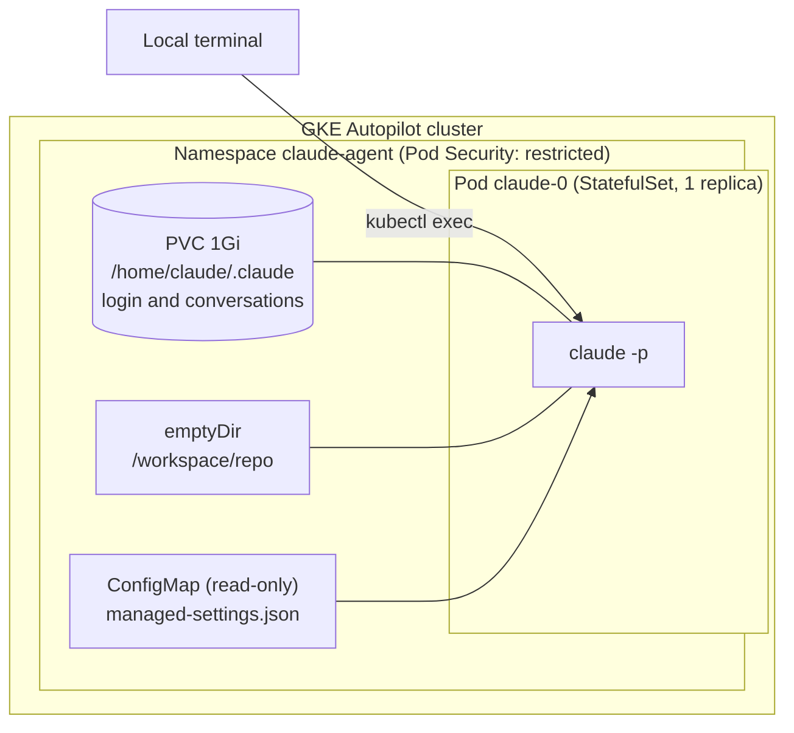
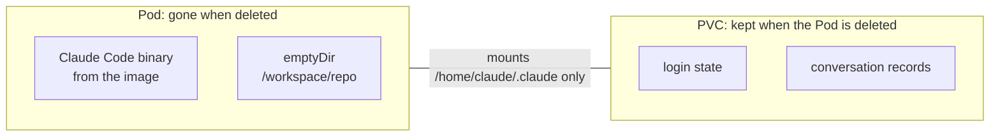

# gke-claude-agent

Run Claude Code in a Pod on GKE Autopilot and drive it from a local terminal with `kubectl exec` and `claude -p`.

Two things are verified:

- A human logs in with a claude.ai account in the browser. No API key or token is used anywhere.
- A conversation continues across calls, and the login and the conversation survive Pod re-creation.

## Architecture



Only the Claude Code config directory (`CLAUDE_CONFIG_DIR`) is on the PVC.
The binary comes from the image and the working directory is an `emptyDir`, so both disappear with the Pod.



The default StorageClass has reclaim policy `Delete`.
Deleting the Pod keeps the login and conversations. Deleting the PVC removes both.

## How it works

| Piece | What it does |
| --- | --- |
| `CLAUDE_CONFIG_DIR=/home/claude/.claude` | Points Claude Code at the PVC for settings, login and conversation records. |
| `CLAUDE_CODE_PROJECT_DIR_NAME=work` | Fixes the project directory name, so records always go to `$CLAUDE_CONFIG_DIR/projects/work/<session-id>.jsonl` regardless of the working directory. It only works when `CLAUDE_CONFIG_DIR` is set, and only from the process environment (set in both the Dockerfile and the StatefulSet). |
| managed settings (ConfigMap) | Highest-precedence settings, mounted read-only at `/etc/claude-code/managed-settings.json`. It pins `forceLoginMethod: claudeai` and `forceLoginOrgUUID`, and denies `Read` on the credentials file. |
| `--session-id` / `--resume` | `claude -p` ends after every call. The first call starts a session with a UUID you choose (`--session-id`); later calls continue it (`--resume`). |

Calls use `kubectl exec` without `-t` or `-i`, so stdout stays clean JSON.

## Layout

| Path | Purpose |
| --- | --- |
| `cluster/create-cluster.sh` | Enables APIs, creates a GKE Autopilot cluster (defaults) and an Artifact Registry repo. |
| `image/` | `Dockerfile` (official installer, pinned version, non-root uid 10001), `cloudbuild.yaml`, `build.sh`. The image is built on Cloud Build because amd64 emulation on an Arm Mac crashed the installer. |
| `k8s/` | Namespace, ServiceAccount (no token mounted), managed-settings ConfigMap, StatefulSet. |
| `deploy.sh` | Applies the manifests, substituting the organization UUID and the image reference from the environment. |
| `bin/claude-pod` | Wrapper: `claude-pod <key> "<prompt>"` derives a session UUID from the key and picks `--session-id` or `--resume`. It limits tools to Read, Grep and Glob. |
| `test/claude-pod-test.sh` | Tests for the wrapper. |
| `RUNBOOK.md` | Deploy and human login steps. |
| `verification.md` | The four verification results with evidence. |
| `research.md`, `preflight.md`, `review-gate.md` | Investigation notes, pre-flight checks and the review gate before applying manifests. |

## Quick start

Identifiers come from environment variables (for example direnv), never from this repo:
`GCP_PROJECT_ID`, `GKE_LOCATION`, `GKE_CLUSTER_NAME`, `AR_REPO`, `REGISTRY_IMAGE`, `CLAUDE_ORG_UUID`.

```bash
bash gke-claude-agent/cluster/create-cluster.sh   # cluster and registry
bash gke-claude-agent/image/build.sh              # build and push the image
bash gke-claude-agent/deploy.sh                   # apply the manifests
```

Log in once. This is a human step; open the printed URL in a browser and approve.

```bash
kubectl exec -it claude-0 -n claude-agent -- claude auth login
```

Then call it.

```bash
bash gke-claude-agent/bin/claude-pod my-chat "The passphrase is banana"
bash gke-claude-agent/bin/claude-pod my-chat "What is the passphrase?"   # same key, same conversation
```

See `RUNBOOK.md` for the full steps and troubleshooting.

## Security notes

- No API key, OAuth token or Secret is used. Login is claude.ai in the browser, with the method and organization pinned by managed settings.
- The Namespace enforces Pod Security `restricted`. The Pod runs as non-root, drops all capabilities and uses the default seccomp profile. No ServiceAccount token is mounted.
- Anyone who can `kubectl exec` into the Pod uses the same claude.ai account and can read every conversation on the PVC.

## Not covered yet

- One Pod and one login. Per-user Pods and PVCs are the next step for multiple users.
- The deny rule covers `Read` only. Whether `Grep` and `Glob` follow it is unconfirmed.
- The cluster API endpoint is public with no authorized-network restriction.
- FQDN-based egress policy is not enabled, so outbound destinations are not restricted.
