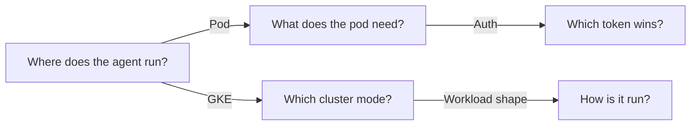
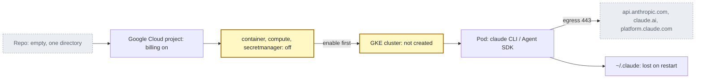
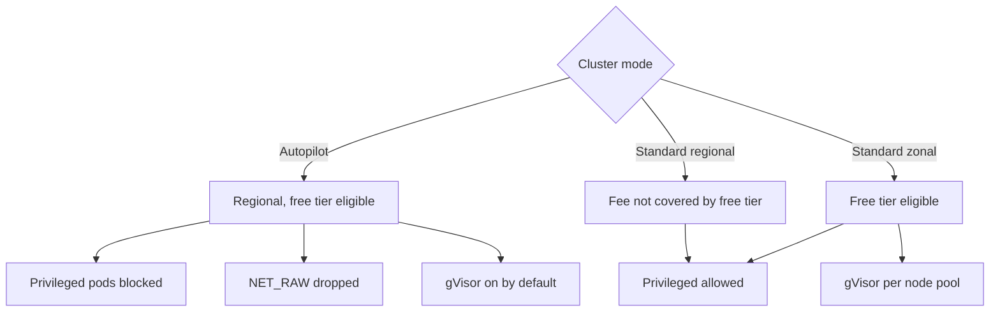
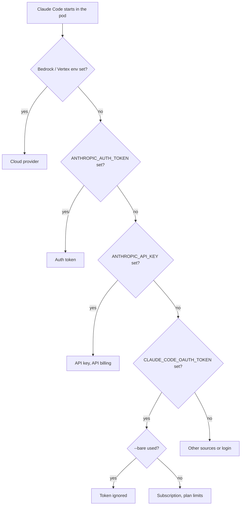
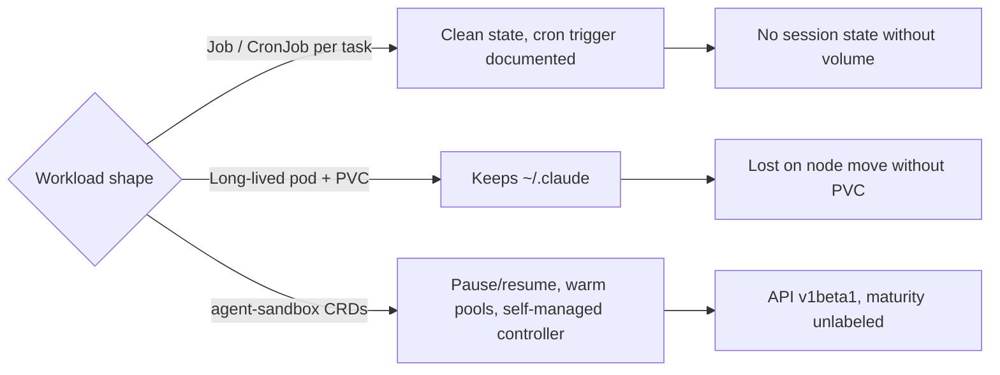

# GKE Claude Code agent research, as diagrams

Source: [research.md](../research.md)

## Map

## Where does the agent run?

Sources: [research.md, Google Cloud project state](../research.md), [Claude Code runtime](../research.md)

## Which cluster mode?

Sources: [research.md, GKE modes](../research.md)

## Which token wins?

Only the first four rungs of the precedence list are drawn; later ones (`apiKeyHelper`, profiles) are collapsed into "Other sources or login".

Sources: [research.md, Claude Code runtime](../research.md)

## How is it run?

Sources: [research.md, platform options](../research.md)
