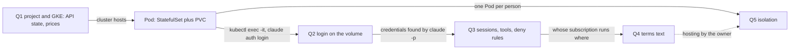
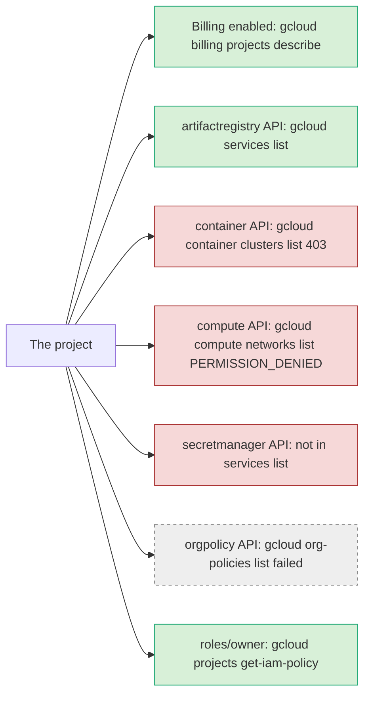
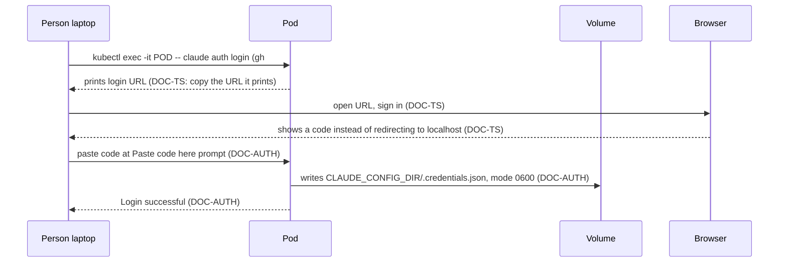
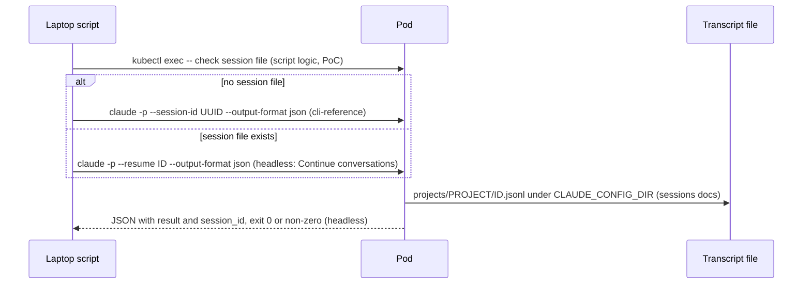
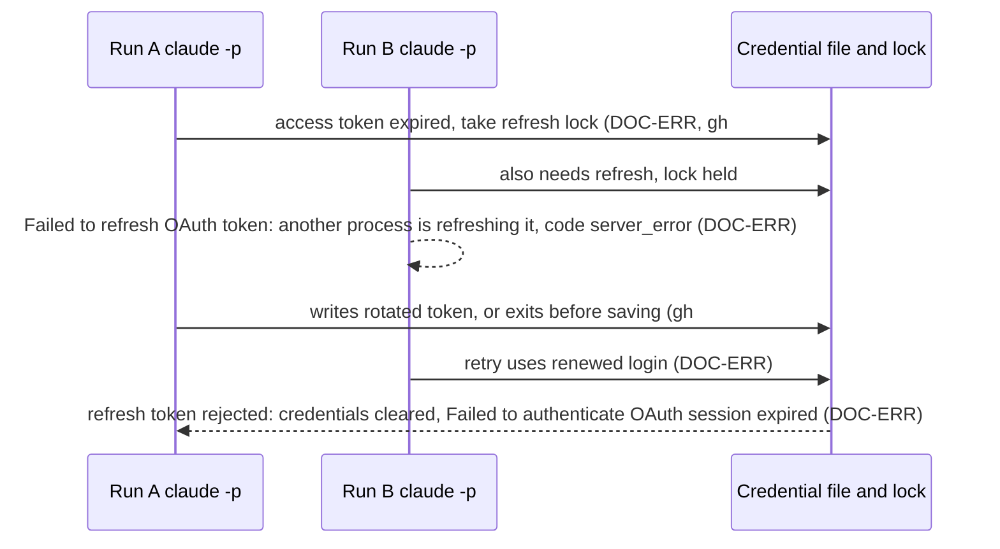
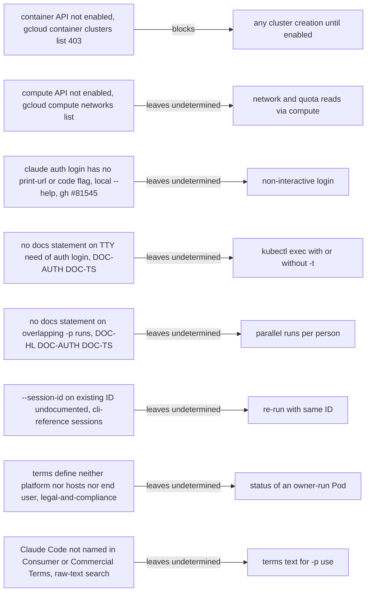
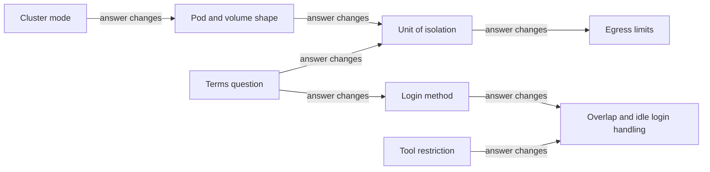

# GKE + per-person Claude Code Pods: research (2026-11-01)

Purpose: feed the plan for a PoC in which the owner runs one Pod per person on GKE in a personal Google Cloud project. Each person logs in to the unmodified Claude Code with their own claude.ai subscription (`claude auth login`, run by that person in the Pod, credentials on a volume). A laptop script runs `claude -p` through `kubectl exec` with session carry-over. This review states facts and the open questions. It makes no recommendation.

Done questions: Q1 prerequisites and cost. Q2 per-person login in a Pod. Q3 session flags, tool limits, deny rules. Q4 terms text. Q5 isolation between people.

Out of scope: Slack, a gateway, an operator-owned token or key, multi-region, production hardening. Constraint from the owner: all repo work lives in the single directory `gke-claude-agent/`.

Verification: the evidence author re-checked against the live source on 2026-11-01 only: Q1 enabled-services state; Q2 the "Login expired" and "another Claude Code process is refreshing it" entries; Q3 `--allowedTools` vs `--tools` wording and `--session-id` "must be a valid UUID"; Q4 Consumer Terms quotes and the legal-and-compliance quotes. Every other fact is sub-agent only and marked "unverified" where it decides a question.

- Issue: kubernetes-playground-mg1 / Commit: 6427a88 on kubernetes-playground-mg1-gke-claude-code-agent-plan

## Findings

### Q1 Prerequisites and cost

Legend: green enabled or present, red not enabled, grey undetermined. Tooling and docs facts that the diagram cannot carry:

| fact | source | → Q1 |
|---|---|---|
| No GKE clusters and no VPC networks could be listed (APIs disabled); whether `default` network exists: undetermined | same commands as above | Q1 |
| Org policy constraints unreadable; `constraints/compute.vmExternalIpAccess` Deny All makes public Autopilot creation fail | autopilot-cluster docs page (creating-an-autopilot-cluster) | Q1 |
| Minimum role: Kubernetes Engine Cluster Admin (Autopilot and zonal pages); node SA needs `roles/container.defaultNodeServiceAccount` | creating-an-autopilot-cluster, creating-a-zonal-cluster | Q1 |
| Whether Compute Engine API must be enabled separately for cluster creation: not stated in pages fetched | docs fetched | Q1 |
| "New Autopilot clusters are regional clusters that have a publicly accessible IP address." | concepts/autopilot-overview | Q1 |
| Default StorageClass is balanced PD (ext4); `standard-rwo` binds at first consumer; PD is zonal (`topology.gke.io/zone`); RWO by default | concepts/persistent-volumes | Q1 |
| Autopilot bills Pod resource requests per second; Running Pods and Pods in CrashLoopBackOff are billed; unscheduled or terminated are not; Autopilot may raise requests to minimums | cloud.google.com/kubernetes-engine/pricing | Q1 |
| No automatic idle scale-down of a StatefulSet Pod described; "Scale to zero using KEDA" appears in docs nav | autopilot-overview nav | Q1 |
| Numeric Autopilot minimums not read: whether 0.5 vCPU / 1 GiB / 2 GiB is accepted as-is is undetermined | concepts/autopilot-resource-requests | Q1 |
| Laptop: `kubectl` and `gke-gcloud-auth-plugin` not installed; `gcloud` 566.0.0 and `docker` installed (Homebrew); install steps `gcloud components install ...`, not run; whether it works with the Homebrew gcloud: undetermined | `command -v`, `gcloud --version`; how-to/cluster-access-for-kubectl | Q1 |
| Push needs `roles/artifactregistry.writer`; an asia-northeast1 Docker repository already exists (`cloud-run-source-deploy`, 0 MB) | artifact-registry pushing-and-pulling; `gcloud artifacts repositories list` | Q1 |

## Flow

Sequence 1: first login (Q2). The TTY need of `claude auth login` is not documented (→ Q2).

Sequence 2: wrapper run (Q3). The behavior of `--session-id` for an existing ID is not documented (→ Q3).

Sequence 3: refresh, expiry, overlapping runs (Q2). Refresh-token rotation is stated by issue authors, not by an Anthropic page (unverified).

## Observed data

| metric | value | query/source | environment | date |
|---|---|---|---|---|
| Billing | enabled | `gcloud billing projects describe` | the project | 2026-11-01 |
| Enabled services | 26, incl. artifactregistry, run, aiplatform; not container, compute, secretmanager, orgpolicy | `gcloud services list --enabled` | the project | 2026-11-01 |
| Account role | `roles/owner` (direct grant only) | `gcloud projects get-iam-policy` | the project | 2026-11-01 |
| Claude Code CLI | 2.1.316 | `claude --version` | laptop | 2026-11-01 |
| Cluster fee | $0.10 per cluster-hour | pricing page; Billing Catalog SKUs (unverified) | asia-northeast1 | 2026-11-01 |
| Free tier | $74.40 per billing account per month, zonal and Autopilot only | pricing page "Free tier" | all | 2026-11-01 |
| Autopilot vCPU | $0.0571 per vCPU-hour | SKU 36BE-CA63-EC2D (unverified) | asia-northeast1 | 2026-10-31 SKU time |
| Autopilot memory | $0.0063215 per GiB-hour | SKU 1598-3115-2C68 (unverified) | asia-northeast1 | same |
| Autopilot ephemeral | $0.0000704 per GiB-hour (SSD variant $0.0001784, which one applies undetermined) | SKU 6CCC-22BA-A597, DB72-B975-7556 (unverified) | asia-northeast1 | same |
| PD balanced / standard | $0.13 / $0.052 per GiB-month | Billing Catalog Compute SKU (unverified) | asia-northeast1 | same |
| Artifact Registry storage | first 0.5 GiB free, then $0.10 per GiB-month | Billing Catalog (unverified) | global | same |
| Pod arithmetic, 0.5 vCPU, 1 GiB, 2 GiB ephemeral, 1 GiB PD, 730 h | vCPU 20.84 + memory 4.61 + ephemeral 0.10 + PD 0.13 = 25.69 USD per month (SSD ephemeral: 25.85) | arithmetic on rows above | Autopilot | 2026-11-01 |
| Cluster fee per month | 0.10 x 730 = 73.00; free-tier credit -74.40 exceeds it | arithmetic | one Autopilot or zonal cluster | 2026-11-01 |
| Not included | egress, Logging and Monitoring ingestion, request rounding, discounts | evidence | - | - |
| Quotas (asia-northeast1) | CPUs 3000, in-use external IPv4 2300, PD standard 204800 GB, PD SSD 81920 GB; all-region CPUs 12000 | `gcloud beta quotas info list --service=compute.googleapis.com` | the project | 2026-11-01 |
| Which quota balanced PD counts against | not stated | compute/resource-usage passage read | - | - |

## External specs

Quotes are from the evidence.

| topic (→ Q4) | original | URL |
|---|---|---|
| Collect or store credentials | "developers may not collect, store, or intermediate Claude.ai credentials or session tokens — sign-in to a Claude account must complete through Anthropic's own flow." | code.claude.com/docs/en/legal-and-compliance |
| End-user carve-out | "Nor does it prevent an end user from signing in to the unmodified Claude Code binary with their own Claude subscription, including where a platform hosts Claude Code as described under Can customers offer Claude Code in their products? above." | same |
| Hosting condition | "preinstalling or running Claude Code in your products or services (e.g. in hosted sandboxes or other agent infrastructure) requires agreeing to our Commercial Terms of Service and complying with the conditions below" | same |
| Conditions | "The Claude Code binary must not be modified." / "Customers may not pay for, resell, or intermediate Claude usage on their end users' behalf. Each end user must authenticate with their own ... Claude subscription plan credentials" | same |
| No sharing | "You may not share your Account login information, Anthropic API key, or Account credentials with anyone else. You also may not make your Account available to anyone else." | anthropic.com/legal/consumer-terms, section 2 |
| Automation | "Except when you are accessing our Services via an Anthropic API Key or where we otherwise explicitly permit it, to access the Services through automated or non-human means, whether through a bot, script, or otherwise." | consumer-terms, section 3 |
| Usage limits | "Advertised usage limits for Pro, Max, and Ultra plans assume ordinary, individual usage of Claude Code and the Agent SDK." | legal-and-compliance, Acceptable use |
| Routing | "Resell, proxy, or otherwise provide access to Claude through unauthorized means, including services that route requests through consumer subscriptions" | anthropic.com/legal/aup |

Versions: Consumer Terms effective Oct 8, 2025. Commercial Terms effective Jun 17, 2025. Usage Policy page shows effective Nov 12, 2026 (later than the fetch date; earlier versions not compared). Legal-and-compliance page shows no date.

Limits and quotas:

| item | value | source |
|---|---|---|
| Pro and Max | five-hour session limit and weekly limit, shared across Claude and Claude Code | support.claude.com article 11145838 |
| Ultra | weekly limit; verified Ultra has no five-hour limit | same |
| Team and Enterprise | Claude Code included with every Team seat; usage-based Enterprise has no per-seat limit | support.claude.com article 11845131 |
| FQDNNetworkPolicy | max 50 resolved IPs; Dataplane V2 required; kube-dns or Cloud DNS | how-to/fqdn-network-policies |
| Namespaces per cluster | 10,000 theoretical | best-practices/enterprise-multitenancy |
| `--pod-running-timeout` | default 1m0s, covers waiting for a Pod only | kubectl_exec reference |
| Transcript retention | `cleanupPeriodDays` default 30, minimum 1 | claude-directory |

## Conventions

None found. The repo has no code conventions; the only code is the PoC files under `gke-claude-agent/poc/`, written in this session.

## Constraints

## Questions for the plan

### Cluster mode: Autopilot vs Standard zonal vs Standard regional

| option | facts for | facts against |
|---|---|---|
| Autopilot | Free tier covers one Autopilot cluster (pricing page, Q1). `kubectl exec` works (autopilot-security, Q1). gVisor on by default (sandbox-pods, Q5). Dataplane V2 default (how-to/network-policy, Q5, unverified). Billed on Pod requests with no node management (pricing, Q1). | New clusters are regional (autopilot-overview, Q1). FQDN policy only via update of an existing cluster, with node restarts of up to a few hours (fqdn page, Q5, unverified). Autopilot may change requests; minimums not read (Q1). Idle Running Pods are billed on requests (pricing, Q1). |
| Standard zonal | Free tier covers one zonal cluster (pricing, Q1). Same Cluster Admin role (creating-a-zonal-cluster, Q1). Calico available (network-policy, Q5, unverified). | Billed by Compute VMs (pricing, Q1). gVisor needs a non-default node pool (sandbox-pods, Q5, unverified). PD is zonal; the Pod must run in the disk's zone (persistent-volumes, Q1). Node-pool scaling to zero details not fetched (Q1). |
| Standard regional | Regional PD exists as a feature (persistent-volumes nav, Q1). | Free tier credit does not apply to the regional cluster fee or its compute (pricing "Free tier", Q1). Regional PD uses twice the quota per GiB (compute/resource-usage, Q1). |

### How a person logs in to a Pod

| option | facts for | facts against |
|---|---|---|
| `kubectl exec -it POD -- claude auth login` (PoC) | Reported as the working manual path in a K8s pod (gh #81545, unverified). Documented container flow is URL printed plus code pasted (DOC-TS, Q2). Credentials persist on a volume (DOC-AUTH dev container case, Q2). | Open reports of the code paste failing with 400 or Invalid code on headless Linux, cause unknown (gh #94708, unverified, Q2). No maintainer reply in any of the ten issues (Q2). A hang report on headless Linux incl. Docker, relation to login not stated (gh #90800, Q2). Whether #94708/#90800 reproduce on 2.1.316: undetermined (Q2). |
| `kubectl exec` without `-t`, over pipes | Author reports the URL printed in plain text over pipes (gh #81545 comment, unverified, Q2). | A user report on one version, no stability guarantee; TTY need undocumented (Q2). |
| `CLAUDE_CODE_OAUTH_REFRESH_TOKEN` with `claude auth login` | Documented: exchanges the token without a browser (DOC-ENV, Q2). | Outside the fixed scenario: someone must supply a refresh token (Q2). Requires `CLAUDE_CODE_OAUTH_SCOPES` (DOC-ENV, Q2). |
| Copy `.credentials.json` from another machine | Worked in one report (gh #94708 comment, unverified, Q2). | A scp copy still prompted for login in an older report (gh #22992, unverified, Q2). Copying also bears on the terms (Q4). |

### Overlapping `claude -p` runs and idle logins

| option | facts for | facts against |
|---|---|---|
| Allow overlapping runs | Docs: parallel sessions on one machine coordinate renewal so one process refreshes at a time (DOC-TS, Q2). Same-Pod execs share one config directory and lock (gh #95822, unverified, Q2). Overlap message is documented as transient (DOC-ERR, Q2). | Two terminals resuming one session without forking interleave into one transcript (sessions, Q3). Before v2.1.211 two sessions could revoke the login (DOC-TS, Q2). Open reports of credentials blanked under concurrent processes: #88583 (macOS, 2.1.229-2.1.251), #98693, #12447 (unverified, Q2). No maintainer reply (Q2). |
| Serialize runs per person | A `-p` run exiting before saving a rotated token (no concurrency) blanked a login (gh #102265, Linux, up to 2.1.303, unverified, Q2). | Serialization does not touch that single-process case (#102265, Q2). The docs state no overlap rule either way (Q2). |
| Idle login | Warning appears 3 days before expiry and never blocks (DOC-AUTH, Q2). Observed access token about 8 hours, refresh token about 29 days (gh #88583 comment, unverified, Q2). | Total lifetime is not documented (Q2). After refresh is rejected credentials are cleared and only `/login` recovers (DOC-ERR, Q2). Short-lived commands such as `claude auth status` or `claude doctor` can lose a rotation (gh #95822, unverified, Q2). |

### How tools are restricted

| option | facts for | facts against |
|---|---|---|
| `--allowedTools` | Pre-approves tools (cli-reference, Q3). `--allowedTools "Read,Grep,Glob"` restores Grep and Glob (tools-reference, Q3, unverified). | "To restrict which tools are available, use `--tools` instead" (cli-reference, Q3). Does not restrict (SDK docs, Q3). Bash stays available; unlisted calls needing approval are denied in `-p` Manual mode from v2.1.302 (headless, permission-modes, Q3). Whether restored on `--resume`: undocumented (Q3). |
| `--tools` | Restricts built-in tools; `""` disables all (cli-reference, Q3). | Does not affect MCP tools (cli-reference, Q3). On Linux Grep and Glob are absent unless named (tools-reference, Q3, unverified). |
| Deny rules (`--disallowedTools`, `permissions.deny`) | A bare name removes the tool; deny beats allow at any level (cli-reference, permissions, Q3). Managed deny cannot be overridden by `--allowedTools` (permissions, Q3). `allowManagedPermissionRulesOnly` makes `--allowedTools` ignored (settings-reference, Q3). | Read deny is best-effort for Grep and Glob (permissions, Q3). Bash coverage is partial: `grep -r pattern .` and scripts are not covered (permissions, Q3). Bash rules are not a security boundary (permissions, Q3). A `/path` rule resolves against the settings source; managed resolution not stated (Q3). |
| Managed settings file in the Pod | `/etc/claude-code/managed-settings.json` on Linux; managed keys cannot be overridden by user or `--settings` (managed-settings, settings, Q2/Q3). | Read-only, symlink and ConfigMap mount behavior not stated; ConfigMap subPath mounts get no updates (volumes page, Q3). Root-only file with non-root user: policy silently not applied (managed-settings, Q2, unverified). Who can write the file in a container: undetermined (Q3). Unparseable file stops startup (Q3). |

### Unit of isolation per person: Pod, or namespace

| option | facts for | facts against |
|---|---|---|
| Pod per person, shared namespace | Names can be unique per Pod. One PSA level for all (pod-security-admission, Q5). | Roles for `pods/exec` can be limited with `resourceNames`, but RBAC is additive (rbac, Q5, unverified). Create-Pod rights in the namespace implicitly allow mounting PVCs (rbac-good-practices, Q5, unverified). ResourceQuota is per namespace only (resource-quotas, Q5). |
| Namespace per person | RBAC, NetworkPolicy, ResourceQuota, LimitRange, PSA are namespace scoped (multi-tenancy, Q5, unverified). GKE guidance: namespaces for logical isolation (enterprise-multitenancy, Q5). K8s: common practice is one namespace per workload (Q5). | Containers share a kernel; namespaces give no kernel isolation (multi-tenancy, Q5). PV is cluster-wide (Q5). Default network is all-to-all until a policy exists (how-to/network-policy, Q5). |
| Access paths that cross the unit | IAM has no per-object grants; `roles/container.developer` includes `pods.exec` and `secrets.get` on all clusters in the project (access-control, iam roles, Q5, unverified). `nodes/proxy` allows exec on every Pod of a node (rbac-good-practices, Q5). `cluster-admin` is a super-user (rbac, Q5). | Contents of `roles/container.clusterViewer` for exec: not read; Compute roles on the PD behind a PVC: not searched (Q5). |
| Runtime sandbox (gVisor, microVM, agent-sandbox) | gVisor default on Autopilot; targets kernel exfiltration between tenants (sandbox-pods, Q5, unverified). agent-sandbox gives stable identity and persistent storage per sandbox (README, Q5, unverified). | `seccomp`, AppArmor and No New Privileges are unsupported in sandboxed Pods; port-forward unsupported under gVisor (sandbox-pods, Q5). `kubectl exec` under gVisor: not stated (Q5). agent-sandbox install is cluster-wide CRDs (README, Q5). Google page example uses 1.0.6 vs upstream v1.0.9 (Q5). It does not isolate the network (sandbox-pods "External dependencies", Q5). |

### How network egress is limited

| option | facts for | facts against |
|---|---|---|
| Kubernetes NetworkPolicy, default-deny egress | Enforced by Dataplane V2 on Autopilot (how-to/network-policy, Q5, unverified). | Default-deny egress also blocks DNS; a DNS rule is needed (network-policies, Q5, unverified). Selectors are IP, Pod, namespace, not hostnames (Q5). Needs a plugin that implements it (Q5). |
| `FQDNNetworkPolicy` (`networking.gke.io/v1alpha1`) | Matches domain names; honors DNS TTL (fqdn page, Q5, unverified). Combines with NetworkPolicy by union (Q5). | Enforced at IP and port; a shared IP allows all domains on it, e.g. `storage.googleapis.com` (Q5). Cannot target ClusterIP Services, so DNS needs a label-based policy (Q5). Max 50 IPs. Autopilot enable by update only (Q5). |
| Host list to allow | Required: `api.anthropic.com`, `claude.ai`, `claude.com`, `platform.claude.com` (OAuth exchange and refresh); `sso.claude.com` for SSO orgs; `mcp-proxy.anthropic.com` for claude.ai users (network-config, Q5, unverified). | Needs for the code-paste login flow beyond this list: not stated (Q5). Cloud NAT for private clusters: not searched (Q5). Optional hosts exist, switchable by env vars (Q5). |

### Terms: operator-hosted storage of a person's login, and the Commercial Terms condition

| option (reading) | facts for | facts against |
|---|---|---|
| Person signs in to the unmodified binary on an owner-run Pod | Carve-out names end users signing in with their own subscription, including where a platform hosts Claude Code (legal-and-compliance, Q4). Usage is billed to the end user (Q4). | "platform", "hosts", "end user", "customers" are not defined (Q4). Whether a personal project's Pod is "hosted sandboxes or other agent infrastructure": not stated (Q4). |
| Login file on an owner-controlled volume | Carve-out covers API keys and cloud provider credentials stored by the customer, not OAuth tokens (Q4). | "developers may not collect, store, or intermediate Claude.ai credentials or session tokens" and Consumer Terms section 2 "may not share ... login information" (Q4). Not defined for a file the unmodified binary writes on the operator's disk and the operator does not read (Q4). "Anthropic's own flow" not described for headless sign-in (Q4). |
| Commercial Terms condition | Running Claude Code in hosted sandboxes "requires agreeing to our Commercial Terms of Service and complying with the conditions below" (Q4). Three conditions: unmodified binary, no paying, reselling or intermediating, name and logo use (Q4). | Commercial Terms say "not for consumer use" and do not contain "Claude Code", "Team", "Enterprise" or "seat"; the Team/Enterprise mapping is only on the Claude Code legal page (Q4). The text does not say how Commercial Terms acceptance fits a Pro or Max user under Consumer Terms, or whether an individual can accept them (Q4). |
| Script running `claude -p` | Terms text on `-p`: none found in any page searched (Q4). | Consumer Terms 3 prohibits "automated or non-human means ... script" except via API key or explicit permission (Q4). "ordinary, individual usage" is not defined (Q4). Support articles say nothing on automation (Q4). |

Could not be determined, and who could answer:

| open item | who could answer |
|---|---|
| Whether an owner-run Pod holding a person's login file counts as "collect, store, or intermediate" | Anthropic sales or support (legal page names sales for authentication questions) |
| Whether `claude -p` through `kubectl exec` is "automated or non-human means" or "explicitly permitted" | Anthropic support |
| How the Commercial Terms condition applies to an individual owner and Pro/Max users | Anthropic sales or support |
| Whether `claude auth login` needs a TTY; whether the code-paste failures in #94708 reproduce on 2.1.316 | A test in a real Pod; Anthropic maintainers |
| Behavior of `--session-id` with an existing ID; `-p` exit code on expired login; whether `--allowedTools` is restored on resume | A test with the CLI (not run: `claude -p` excluded in research) |
| Whether Compute Engine API must be enabled for cluster creation; org policy constraints; Autopilot minimum requests | A test in the project; Google docs |
| Whether exec works under gVisor; roles able to read the PD behind a PVC; ResourceQuota vs Autopilot mutated requests | Google docs; a test in a real cluster |
| Refresh-token lifetime, rotation, whether the lock works across Pods sharing a volume | Anthropic support |

## Out of scope findings

- `claude setup-token` creates a one-year token that can only make model requests and cannot establish Remote Control sessions (DOC-AUTH); the issue #22992 reports subscription features missing with `CLAUDE_CODE_OAUTH_TOKEN`. Belongs to the operator-owned token issue.
- `forceLoginMethod` and `forceLoginOrgUUID` details (DOC-SR, DOC-MS); whether `claude auth login` enforces them: undetermined. Belongs to a policy issue.
- Agent Substrate on GKE (actor-based, Standard only) and Agent Sandbox pricing "no extra charge" (how-install-agent-sandbox). Belongs to a runtime-isolation issue.
- Devcontainer "Persist authentication and settings across rebuilds" page: linked from DOC-AUTH, not read.
- `claude -p --bare` does not read OAuth credentials (DOC-HL); relevant to any later wrapper change.
- Slack, gateway, multi-region and production hardening: not researched.

## Sources

- Claude Code docs, code.claude.com/docs/en/: authentication (DOC-AUTH), errors (DOC-ERR), claude-directory (DOC-DIR), managed-settings (DOC-MS), settings-reference (DOC-SR), troubleshoot-install (DOC-TS), headless (DOC-HL), cli-reference, env-vars (DOC-ENV), settings, sessions, permissions, permission-modes, tools-reference, agent-sdk/typescript, network-config, legal-and-compliance.
- Terms: anthropic.com/legal/consumer-terms, anthropic.com/legal/commercial-terms, anthropic.com/legal/aup; support.claude.com/en/articles/11145838 and /11845131.
- Issues anthropics/claude-code: #81545, #22992, #94708, #90906, #90800, #98693, #88583, #102265, #95822, #12447 (read with `gh issue view`).
- Google Cloud docs at docs.cloud.google.com/kubernetes-engine/docs: creating-an-autopilot-cluster, creating-a-zonal-cluster, concepts/autopilot-overview, autopilot-security, autopilot-resource-requests, persistent-volumes, sandbox-pods, access-control, best-practices/enterprise-multitenancy, how-to/network-policy, fqdn-network-policies, how-install-agent-sandbox, api-server-authentication, cluster-access-for-kubectl, quotas; cloud.google.com/kubernetes-engine/pricing; artifact-registry pushing-and-pulling; compute/resource-usage; iam roles container.
- Kubernetes docs at kubernetes.io/docs: multi-tenancy, pod-security-standards, pod-security-admission, rbac, rbac-good-practices, resource-quotas, limit-range, network-policies, volumes, kubectl_exec reference, get-shell-running-container; kubernetes/kubernetes `exec.go` and `helpers.go`.
- github.com/kubernetes-sigs/agent-sandbox README and `gh api repos/kubernetes-sigs/agent-sandbox/releases/latest` (v1.0.9).
- Commands: `gcloud billing projects describe`, `gcloud services list --enabled`, `gcloud container clusters list`, `gcloud compute networks list`, `gcloud org-policies list`, `gcloud projects get-iam-policy`, `gcloud artifacts repositories list`, `gcloud beta quotas info list`, Cloud Billing Catalog API, `claude --version`, `claude auth login --help`, `claude --help`.

## Gaps

- Wrapper behavior of the PoC files under `gke-claude-agent/poc/` was not described in the evidence; Flow sequence 2 shows the script logic only as the task statement gives it.
- Exit code of a failing `-p` run on expired login: not in the evidence.
- Enforcement wording of the Usage Policy: the evidence's extraction was truncated.
