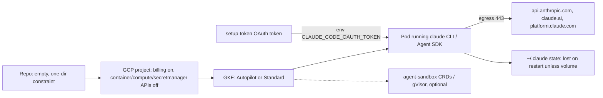

# GKE for a Claude Code agent platform: research (2026-11-01)

Question: what has to be known before planning "spin up GKE in `kauche-personal-k-takahashi`, run the owner's own Claude Code as an agent on it (authenticated with a Claude subscription token), with an AI agent platform as the long-term goal". Why: the issue's stated goal. Out of scope: choosing an approach, writing manifests, enabling any API (research was read-only).

- Issue: kubernetes-playground-mg1 / Commit: 29ac114 on kubernetes-playground-mg1-gke-claude-code-agent-plan
- All external pages fetched 2026-11-01. "Verified" = re-checked by me; others are sub-agent reports.

## Summary

- The repo holds no code or infra yet (`git ls-files`: only beads/agent config). Everything is greenfield.
- In the project, billing is enabled, and Artifact Registry, Vertex AI (`aiplatform`) and Cloud Build are enabled. `container`, `compute` and `secretmanager` APIs are NOT enabled (verified, `gcloud services list`). So no cluster or network can exist/was inspectable, and quotas and K8s versions are undetermined.
- Autopilot blocks privileged containers (root allowed) and drops `NET_RAW`; Standard permits privileged mode. One free Autopilot or zonal Standard cluster per billing account per month (verified); cluster fee is otherwise $0.10/h in every mode.
- `claude setup-token` yields a 1-year OAuth token (`CLAUDE_CODE_OAUTH_TOKEN`) documented for "CI pipelines and scripts". Anthropic's policy text restricts routing plan credentials on behalf of others (verified) but does not say whether own-account use in a self-run pod is "ordinary, individual usage". Open.
- No Anthropic or Google official guide for Claude Code in a GKE pod was found. Anthropic's hosting docs list API-key/cloud-provider auth only, and a cookbook `kubernetes/` folder (contents not read).
- Constraint from the owner: this work lives in a single directory of this multi-experiment repo.

## Findings

### GCP project state
| what | value | where |
|---|---|---|
| billing | enabled | `gcloud billing projects describe` (verified) |
| enabled | aiplatform, artifactregistry, containerregistry, cloudbuild, iam, logging, monitoring, run, storage, pubsub and others | `gcloud services list --enabled` (verified for aiplatform/artifactregistry/containerregistry) |
| not enabled | container, compute, secretmanager | same (verified) |
| clusters, networks, server-config, CPU/IP quotas | not determined: calls fail with SERVICE_DISABLED | sub-agent run of `gcloud container clusters list`, `compute networks list`, `get-server-config` |

### GKE modes
| what | Autopilot | Standard | source |
|---|---|---|---|
| privileged pods | blocked (partner-deployed excepted) | allowed | docs.cloud.google.com/kubernetes-engine/docs/concepts/choose-cluster-mode, .../autopilot-security |
| root user | allowed | allowed | autopilot-security |
| NET_RAW / NET_ADMIN | NET_RAW dropped; NET_ADMIN only with `--workload-policies=allow-net-admin` | configurable | autopilot-security |
| node SSH | blocked | available | autopilot-security |
| Workload Identity | on by default | default not verified | autopilot-security |
| billing | per Pod CPU/memory/ephemeral-storage requests, per second, no minimum (general-purpose classes) | Compute Engine VMs per second | cloud.google.com/kubernetes-engine/pricing |
| cluster | always regional | zonal or regional | quotas page |
| gVisor (GKE Sandbox) | on by default, per search summary | per node pool `--sandbox=type=gvisor`, not on default pool | sandbox-pods page (404 on direct fetch; search summary only) |

### Pricing and quotas
| item | value | source |
|---|---|---|
| management fee | $0.10/cluster/hour, all modes | pricing page (sub-agent) |
| free tier | $74.40/month/billing account = one Autopilot or zonal Standard cluster; not for regional Standard fee | pricing page (verified) |
| limits | 100 clusters/zone or region/project; pods/node 8-256 (Autopilot), 512 (Standard) | docs.cloud.google.com/kubernetes-engine/quotas |
| Autopilot per-vCPU rates, scale-to-zero semantics | not determined | - |

### Claude Code runtime
| what | fact | source |
|---|---|---|
| headless | `claude -p`; formats text/json/stream-json; Agent SDK (Python/TS) wraps a spawned `claude` subprocess | code.claude.com/docs/en/headless, .../agent-sdk/hosting |
| non-interactive permissions | tools need `--allowedTools`, a permission mode (`dontAsk`, `acceptEdits`, `auto`) or hook; unapproved calls are denied | headless |
| `--bare` | does not read `CLAUDE_CODE_OAUTH_TOKEN` | .../authentication |
| precedence | cloud-provider env > `ANTHROPIC_AUTH_TOKEN` > `ANTHROPIC_API_KEY` (always used in `-p` when set) > ... > `CLAUDE_CODE_OAUTH_TOKEN` | authentication |
| root | CLI rejects `--dangerously-skip-permissions` as root | .../devcontainer |
| resources | "1 GiB RAM, 5 GiB disk, and 1 CPU per agent is a reasonable starting point" | hosting |
| state | `~/.claude/`, `~/.claude.json`; relocatable via `CLAUDE_CONFIG_DIR`; does not survive restart/reschedule | hosting |
| egress | api.anthropic.com, claude.ai, platform.claude.com (OAuth exchange/refresh) required; others optional | .../network-config |
| devcontainer firewall | `init-firewall.sh` needs `NET_ADMIN` and `NET_RAW` | devcontainer |

## Flow (agent platform options)
| option | status (checked 2026-11-01) | needs | source |
|---|---|---|---|
| kubernetes-sigs/agent-sandbox | v1.0.9 (2026-10-29), Apache-2.0, CRD API v1beta1, no maturity label in README | controller in-cluster; RuntimeClass (gVisor/Kata) | github.com/kubernetes-sigs/agent-sandbox |
| GKE Agent Sandbox (Google docs) | you install/upgrade controller; Autopilot and Standard; pod snapshots need GKE 1.35.3+; Preview/GA not stated | gVisor or microVM | docs.cloud.google.com/kubernetes-engine/docs/concepts/machine-learning/agent-sandbox |
| kagent (CNCF Sandbox) | v1.0.0-rc1 (2026-10-30), Apache-2.0, built on Google ADK | LLM API key Secret | github.com/kagent-dev/kagent |
| Coder Tasks | removal from new releases from v2.37 per its docs; AGPL-3.0 | Coder server | coder.com/docs/@main/ai-coder/tasks |
| CronJob per task (blog) | `backoffLimit 1`, deadline 4h, Secret env, no PVC, `--dangerously-skip-permissions`; cron trigger only | plain K8s | dev.to/hnykda/running-claude-code-as-a-kubernetes-job-25d1 |
| Argo Workflows / Tekton | generic engines; no coding-agent docs found | CRDs + controller | github.com/argoproj/argo-workflows, tektoncd/pipeline |

Egress: sandboxes made from a SandboxTemplate get a controller-created NetworkPolicy; direct Sandbox resources get none (GKE agent-sandbox doc). Google tutorials exist for ADK + Vertex AI on GKE (docs.cloud.google.com/kubernetes-engine/docs/tutorials/agentic-adk-vertex).

## External specs
Policy, `code.claude.com/docs/en/legal-and-compliance` (verified verbatim):
> "OAuth authentication is intended exclusively for purchasers of Claude Free, Pro, Max, Ultra, Team, and Enterprise subscription plans and is designed to support ordinary use of Claude Code and other native Anthropic applications."
(JA: OAuth認証はサブスクリプション購入者専用で、Claude Codeなどの通常利用を支援する設計。)
> "Advertised usage limits for Pro, Max, and Ultra plans assume ordinary, individual usage of Claude Code and the Agent SDK."
> "Anthropic does not permit third-party developers ... to route requests through Free, Pro, Max, or Ultra plan credentials on behalf of their users. Moreover, developers may not collect, store, or intermediate Claude.ai credentials or session tokens."

`setup-token` (authentication page, sub-agent): one-year token, "can only make model requests", for "CI pipelines and scripts where browser login isn't available". Plan limits: five-hour and weekly, shared with claude.ai (support.claude.com/en/articles/11145838). Consumer Terms text was not read.

## Conventions
none found (empty repo; only `.claude/settings.json`, `.codex/`, beads files).

## Constraints
| constraint | source | direct consequence |
|---|---|---|
| all work in a single directory | owner, this session | infra, manifests and docs share one subtree of the repo |
| container/compute APIs disabled | `gcloud services list` | enabling them is a prerequisite write; quotas/versions unknown until then |
| setup-token is bound to the subscription of the person who ran it | GitHub Action doc (sub-agent) | the pod runs on the owner's plan limits, shared with claude.ai |
| `ANTHROPIC_API_KEY` outranks the OAuth token | authentication page | an API key present in the pod env silently changes billing |
| token passes through a Secret | policy text above | storing it in-cluster is the "store credentials" area the policy words around; applicability to own-account use is unclear |
| `~/.claude` is not durable | hosting doc | needs a volume or SessionStore for session continuity |

## Questions for the plan

### Autopilot or Standard?
| option | facts for | facts against |
|---|---|---|
| Autopilot | free-tier eligible; Workload Identity default; gVisor on by default; no node management | no privileged pods; NET_RAW dropped (devcontainer firewall script not usable as-is) |
| Standard zonal | free-tier eligible; privileged allowed | node capacity planning; gVisor per node pool |
| Standard regional | HA | fee not covered by free tier |

### Is own-account subscription token use in an unattended pod acceptable?
| option | facts for | facts against |
|---|---|---|
| subscription token | setup-token documented for CI/scripts; policy allows signing in with own subscription on a platform hosting Claude Code | policy: limits assume "ordinary, individual usage"; no text on server pods; Agent SDK users told to use API keys |
| API key | hosting docs' only documented auth | separate API billing |
| Vertex AI (aiplatform already enabled) | documented Claude Code provider; WIF/Workload Identity | model access/quota in project not checked |

### Workload shape: long-lived vs per-task?
| option | facts for | facts against |
|---|---|---|
| Job/CronJob per task | documented blog pattern; clean state | no session state without volume; only cron trigger found documented |
| long-lived pod + PVC | keeps `~/.claude` | state lost on node move without PVC |
| agent-sandbox CRDs | stateful singleton, pause/resume, warm pools; relates to long-term platform | controller self-managed; maturity unlabeled |

### Others
- How the agent is triggered (Slack, webhook, schedule): no source found.
- Which directory name in the repo.

| not determined | who could answer |
|---|---|
| terms applicability to own pod | Anthropic support / Consumer Terms |
| quotas, K8s versions, networks | needs `container`/`compute` APIs enabled (owner decision) |
| Autopilot rates, scale-to-zero | GKE pricing calculator / docs |
| cookbook `kubernetes/` manifests | read repo directly |

## Out of scope findings
Small community Claude Code operators exist (e.g. AhmadMasry/claude-self-hosted-environment-operator, 5 stars); not evaluated.

## Sources
code.claude.com/docs/en/{headless,authentication,legal-and-compliance,agent-sdk/hosting,devcontainer,network-config}; support.claude.com/en/articles/11145838; github.com/anthropics/claude-cookbooks (claude_agent_sdk/hosting); cloud.google.com/kubernetes-engine/pricing; docs.cloud.google.com/kubernetes-engine/docs/{concepts/choose-cluster-mode,concepts/autopilot-security,quotas,concepts/machine-learning/agent-sandbox,tutorials/agentic-adk-vertex}; github.com/kubernetes-sigs/agent-sandbox; github.com/kagent-dev/kagent; coder.com/docs/@main/ai-coder/tasks; dev.to/hnykda/running-claude-code-as-a-kubernetes-job-25d1; gcloud read-only calls (`services list`, `billing projects describe`, `container clusters list`).
