# Claude Code in a GKE Pod (claude -p via kubectl exec) research (2026-11-01)

Purpose: collect facts for a PoC plan that runs Claude Code in a Pod on GKE and calls `claude -p` from a laptop via `kubectl exec`, to check that sessions carry over between calls.

Scenario: one person with their own claude.ai subscription. A human runs `claude auth login` inside the Pod. The Pod is a non-root StatefulSet (replicas 1) in its own Namespace, with a ServiceAccount that has no GCP permissions. A PVC sits at CLAUDE_CONFIG_DIR, cwd is /workspace/repo, and managed-settings.json comes from a read-only ConfigMap (forceLoginMethod claudeai, forceLoginOrgUUID placeholder, deny rules on the credentials file). A NetworkPolicy is optional. The wrapper `claude-pod <key> "<prompt>"` derives a UUIDv5 from the key, uses `--session-id` when the session file is absent and `--resume` when present, with `--output-format json` and `--allowedTools` Read/Grep/Glob. Forbidden: CLAUDE_CODE_OAUTH_TOKEN, ANTHROPIC_API_KEY, ANTHROPIC_AUTH_TOKEN, reading `.credentials.json`, modifying the binary, automating login.

Done questions:
1. Q1: install, non-root image, config/credential/transcript storage.
2. Q2: CLI session semantics, JSON output, tool restriction, session file layout.
3. Q3: managed settings and deny rules.
4. Q4: GKE side (storage, security, network, registry, kubectl access).
5. Q5: login flow, billing, terms, endpoints.

Out of scope: Slack, gateway, multi-user, API-key auth, automating login.

- Issue: kubernetes-playground-mg1 (title: Spin up GKE for AI agent platform) / Commit: fec96d1 on branch kubernetes-playground-mg1-gke-claude-code-agent-plan

Source key: docs = https://code.claude.com/docs/en/<page>. Docs fetched 2026-11-01; they mention Claude Code up to v2.1.302. "sub-agent" = not re-checked by a second fetch.

## Findings

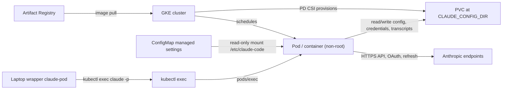

### Image and install

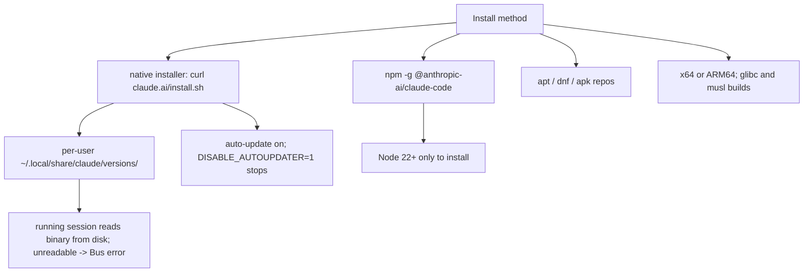

| Attribute | Fact | Source |
|---|---|---|
| Installer args | `-s stable` or a version number | docs/setup (sub-agent) → Q1 |
| npm | "The installed `claude` binary does not itself invoke Node."; do not use sudo npm | docs/setup (sub-agent) → Q1 |
| apt/dnf/apk | repos at downloads.claude.ai; no auto-update | docs/setup (sub-agent) → Q1 |
| Requirements | Ubuntu 20.04+, Debian 10+, Alpine 3.19+; 4 GB+ RAM; Alpine needs libgcc, libstdc++, ripgrep, `USE_BUILTIN_RIPGREP=0`; no-AVX CPUs give "Illegal instruction" | docs/setup, docs/troubleshoot-install (sub-agent) → Q1 |
| Official non-root Dockerfile | `USER node`, npm install of pinned version, `mkdir -p /workspace /home/node/.claude && chown -R node:node` | https://raw.githubusercontent.com/anthropics/claude-code/main/.devcontainer/Dockerfile (sub-agent) → Q1 |
| Updates | `DISABLE_UPDATES=1` blocks all; docs/devcontainer: pin via npm version and set `DISABLE_AUTOUPDATER`; native installer deletes old versions itself | docs/setup, docs/env-vars, docs/devcontainer (sub-agent) → Q1 |
| Root | `--dangerously-skip-permissions` rejected as root | docs/devcontainer (sub-agent) → Q1 |
| Traffic switch | `CLAUDE_CODE_DISABLE_NONESSENTIAL_TRAFFIC` disables auto-updates, telemetry, error reporting, /feedback, feature-flag fetching | docs/env-vars (sub-agent) → Q3 |

### Sessions and CLI

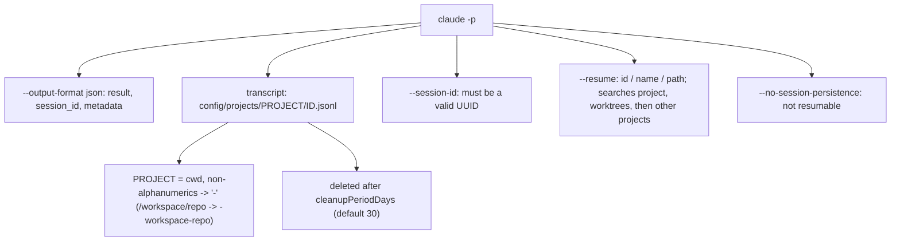

| Attribute | Fact | Source |
|---|---|---|
| Existing id with `--session-id` | Not in docs. Issue #86761 (open, v2.1.232): `Session ID <uuid> is already in use`, guard described by issue author as "a plain 'does <uuid>.jsonl already exist' test". Issue #87399 (closed): "in use" with no .jsonl, jobs registry (Windows, background) | github.com/anthropics/claude-code/issues/86761, /87399 (sub-agent) → Q2 |
| Missing id on resume | `No conversation found with session ID: <id>`; exit code not documented; hand-copied duplicate in a second project gives not-found | docs/cli-reference, docs/sessions, docs/headless (sub-agent) → Q2 |
| Resume cwd | Issue #5768 (open, v1.0.80): resume worked only from the starting directory; docs state global lookup (v2.1.223+) | github.com/anthropics/claude-code/issues/5768 (sub-agent) → Q2 |
| Same id on resume | `--fork-session` creates a new id; equality of session_id after plain resume is inferred, not shown in docs | docs/cli-reference (sub-agent) → Q2 |
| Concurrency | Resuming the same session twice without forking interleaves into one transcript; issue #75761 (closed): two live processes append to one jsonl; no issue found on concurrent `claude -p --resume` | docs/sessions; issue #75761 (sub-agent) → Q2 |
| Not restored on resume | `--mcp-config`, `--settings`, `--plugin-dir`, `--add-dir`, `--fallback-model`; permission mode is what a new `-p` run would start with | docs/sessions (sub-agent) → Q2 |
| JSON shape | No literal example in docs; SDK `SDKResultMessage` has `type, subtype, session_id, is_error, num_turns, result, total_cost_usd, usage, permission_denials, ...`; error subtypes carry `errors[]` and no `result`; equivalence to CLI JSON not stated | docs/headless; docs/agent-sdk/typescript (sub-agent) → Q2 |
| Exit codes | 0 success, non-zero failure; in-run failures (e.g. missing auth) printed as result on stdout; SIGTERM 143; per-failure codes not documented | docs/headless (sub-agent) → Q2 |
| Empty output | Issue #98610 (open): `claude -p --resume` printed empty stdout with exit 0 on a refusal-fallback turn | github.com/anthropics/claude-code/issues/98610 (sub-agent) → Q2 |
| Hidden from picker | `-p` sessions are hidden from the picker and `--continue`; `--resume <id>` finds them; `-p --continue` includes them | docs/sessions, docs/cli-reference (sub-agent) → Q1 |
| Project dir name | `CLAUDE_CODE_PROJECT_DIR_NAME` (v2.1.234+) fixes the name; ignored unless CLAUDE_CONFIG_DIR set; 1-64 letters/digits/hyphens/underscores; names over 200 chars truncated plus hash | docs/sessions, docs/claude-directory (sub-agent) → Q1 |
| Retention | `cleanupPeriodDays` default 30, min 1, 0 is a validation error; mtime-vs-creation basis not stated | docs/claude-directory (sub-agent) → Q1 |

### Managed settings and deny

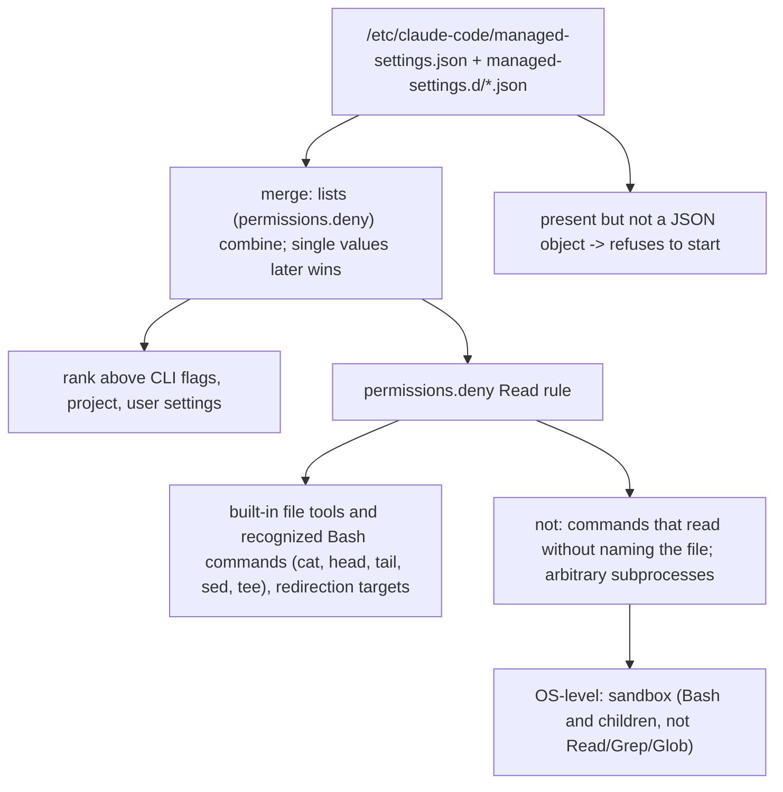

| Attribute | Fact | Source |
|---|---|---|
| Precedence | "Nothing in your own settings files or `--settings` overrides a managed key"; `forceLogin*` and `permissions.deny` not among lower-scope exceptions | docs/settings (sub-agent) → Q3 |
| Multiple managed sources | `managedSourcesBehavior` default "first-wins"; remote fetched only for direct Anthropic API auth with an eligible credential | docs/managed-settings (sub-agent) → Q3 |
| Symlinks, reload | Symlinks accepted; files watched and reloaded. Docs do not say if Claude Code writes the managed file; no mention of read-only mounts or ConfigMap subPath | docs/managed-settings, docs/settings (sub-agent) → Q3 |
| Path syntax | `//path` absolute, `~/path` home, `/path` relative to settings source, `path`/`./path` relative to cwd; no managed-settings row for `/path`; env vars in rule paths: not documented | docs/permissions (sub-agent) → Q3 |
| Grep/Glob | Read rules apply "best-effort" to Grep and Glob; deny matches requested path or symlink target; Read deny also blocks Edit/Write | docs/permissions (sub-agent) → Q3 |
| `-p` | No statement that deny is skipped or confirmed in `-p`; `-p` counts as trusted | docs/settings, docs/permissions (sub-agent) → Q3 |
| Other keys | `allowManagedPermissionRulesOnly` (also ignores `--allowedTools`), `permissions.disableBypassPermissionsMode`, `permissions.disableAutoMode`, `permissions.blockReadsOutsideWorkingDirectories`, managed `env`, `apiKeyHelper`, `cleanupPeriodDays` | docs/settings-reference (sub-agent) → Q3 |
| Tool flags | `--allowedTools`: "Tools that execute without prompting for permission ... To restrict which tools are available, use `--tools` instead." `--tools` "doesn't affect MCP tools". Bare name in `--disallowedTools` removes the tool; `Bash(rm *)` only denies matching calls | docs/cli-reference (verified by second fetch for first two) → Q2 |
| Auto-approved reads | Read/Grep/Glob need no approval in working directory and added dirs; Glob and Grep absent by default on macOS/Linux/WSL; naming either in `--tools` or `--allowedTools` restores both | docs/permissions, docs/tools-reference (sub-agent) → Q2 |
| Modes | `-p` with no mode starts in Manual mode from v2.1.302; `dontAsk` auto-denies prompts | docs/headless, docs/permission-modes (sub-agent) → Q2 |
| Without `--bare` | `-p` runs project hooks and connects `.mcp.json` servers even in an untrusted folder | docs/headless (sub-agent) → Q2 |

### GKE storage, security, network

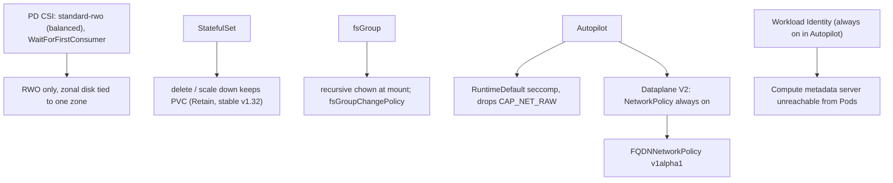

| Attribute | Fact | Source |
|---|---|---|
| Storage classes | Default balanced PD ext4; `standard-rwo`, `premium-rwo`; Autopilot default `standard-rwo`; `reclaimPolicy: Delete` described as default policy, standard-rwo's own value not stated | https://docs.cloud.google.com/kubernetes-engine/docs/concepts/persistent-volumes (sub-agent) → Q4 |
| fsGroup | No effect on configMap/secret/emptyDir; large PVs can make mounts fail; PD driver VOLUME_MOUNT_GROUP support not determined; unset runAsGroup means primary GID 0 | https://kubernetes.io/docs/tasks/configure-pod-container/security-context/ (sub-agent) → Q4 |
| Autopilot requests | Min 50m CPU / 52 MiB (bursting) or 250m / 512 MiB; max 30 vCPU / 110 GiB; ephemeral 10 MiB-10 GiB; CPU:memory 1:1 to 1:6.5 | https://docs.cloud.google.com/kubernetes-engine/docs/concepts/autopilot-resource-requests (sub-agent) → Q4 |
| Restricted PSS | runAsNonRoot true, runAsUser not 0, allowPrivilegeEscalation false, drop ALL, seccompProfile RuntimeDefault/Localhost; allowPrivilegeEscalation defaults true if unset | https://kubernetes.io/docs/concepts/security/pod-security-standards/ (sub-agent) → Q4 |
| NetworkPolicy | Dataplane V2 default on Autopilot; Calico only in Standard; by default all Pods communicate freely; standard policy is IP/CIDR based | https://docs.cloud.google.com/kubernetes-engine/docs/how-to/network-policy; https://kubernetes.io/docs/concepts/services-networking/network-policies/ (sub-agent) → Q4 |
| DPv2 + WI egress | Allow `169.254.169.254/32` ports 80, 8080; DNS must be allowed for workloads and `node-local-dns`; no exact default-deny-egress-plus-DNS manifest found | network-policy page; .../how-to/nodelocal-dns-cache (sub-agent) → Q4 |
| FQDN policy | `networking.gke.io/v1alpha1`; requires DPv2, kube-dns or Cloud DNS, gcloud 462.0.0+; max 50 resolved IPs per policy, 100 IPs per hostname quota; on Autopilot enabled only by updating an existing cluster | https://docs.cloud.google.com/kubernetes-engine/docs/how-to/fqdn-network-policies (sub-agent) → Q4 |
| Pod identity | Without Workload Identity, Pods inherit the node service account; Pods without a KSA use namespace `default` KSA; `automountServiceAccountToken: false` stops only the Kubernetes API token | https://docs.cloud.google.com/kubernetes-engine/docs/concepts/workload-identity; https://kubernetes.io/docs/tasks/configure-pod-container/configure-service-account/ (sub-agent) → Q4 |
| Registry | Push path `LOCATION-docker.pkg.dev/PROJECT/REPO/IMAGE:TAG`; GKE pulls with Compute Engine default SA, `roles/artifactregistry.reader` if Editor grant disabled | https://docs.cloud.google.com/artifact-registry/docs/docker/authentication; .../integrate-gke (sub-agent) → Q4 |
| Architecture | GKE schedules to x86 by default; Arm nodes tainted `kubernetes.io/arch=arm64:NoSchedule`; multi-arch images run on either | https://docs.cloud.google.com/kubernetes-engine/docs/how-to/prepare-arm-workloads-for-deployment (sub-agent) → Q4 |
| kubectl access | `gke-gcloud-auth-plugin`, then `get-credentials`; exec needs `pods/exec` subresource, verb `create` | https://docs.cloud.google.com/kubernetes-engine/docs/how-to/cluster-access-for-kubectl (sub-agent) → Q4 |
| This machine | No kubectl, no kube config; gcloud and docker present; cluster type, node arch, storage classes, enforcement not checked | local check 2026-11-01 → Q4 |

### Login, billing, terms

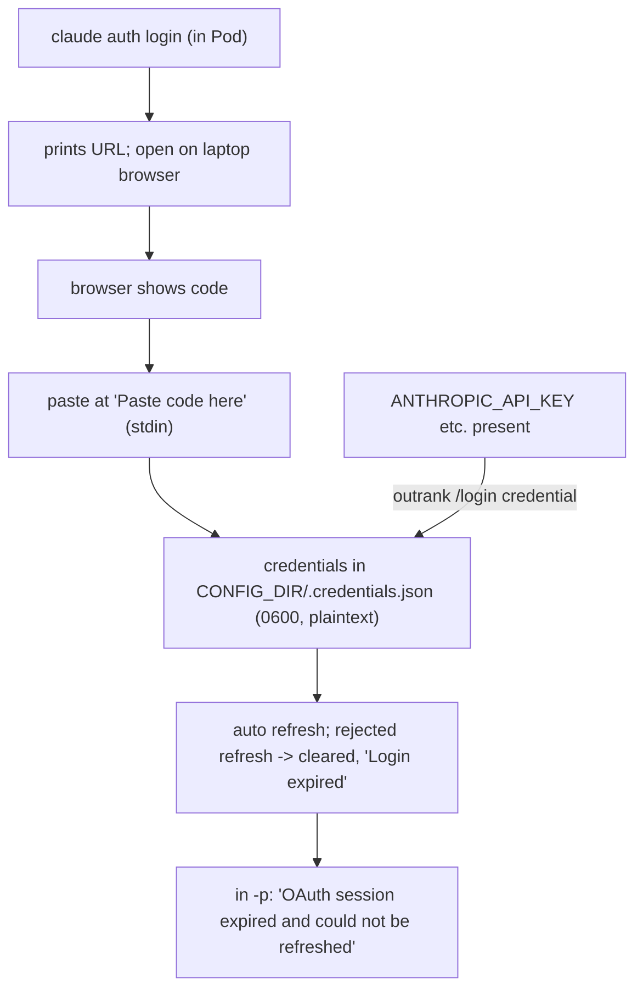

| Attribute | Fact | Source |
|---|---|---|
| Login options | `--email`, `--sso`, `--console` (API billing); `claude auth status` exits 0/1, JSON; `configDirectory` field v2.1.268+; no `--claudeai` flag, `claudeai` only as `forceLoginMethod` value | docs/cli-reference (sub-agent) → Q5 |
| Refresh | Parallel sessions on one machine share a lock; `/login` unavailable in `-p`; warning 3 days before expiry; TTLs not stated | docs/errors, docs/troubleshoot-install, docs/authentication, docs/headless (sub-agent) → Q5 |
| Precedence | Cloud-provider vars, `ANTHROPIC_AUTH_TOKEN`, `ANTHROPIC_API_KEY` ("In non-interactive mode (`-p`), the key is always used when present"), `apiKeyHelper`, `CLAUDE_CODE_OAUTH_TOKEN`, Anthropic profile all rank above the `/login` credential | docs/authentication (sub-agent) → Q5 |
| Console login | `claude auth login --console` stores a profile in `~/.config/anthropic`, outside CLAUDE_CONFIG_DIR | docs/authentication (sub-agent) → Q1 |
| Billing | "when you're signed in with your Claude plan, the Claude Agent SDK and `claude -p` still draw from your subscription limits." (Oct 7, 2026 update); June 15, 2026: changes paused | https://support.claude.com/en/articles/15036540-use-the-claude-agent-sdk-with-your-claude-plan (verified by second fetch) → Q5 |
| Limits | Advertised limits "assume ordinary, individual usage"; Claude Code and chat share limits | docs/legal-and-compliance; https://support.claude.com/en/articles/11145838-using-claude-code-with-your-pro-or-max-plan (sub-agent) → Q5 |
| forceLoginOrgUUID | Only managed source enforces; mismatch -> exit at startup; empty array or wrong type -> cannot start or log in; named for Terminal, VS Code, Agent SDK logins; `claude auth login` not named; placeholder handling undocumented | docs/settings-reference, docs/authentication (sub-agent) → Q3, Q5 |
| Blocked at startup | `ANTHROPIC_API_KEY`, `ANTHROPIC_AUTH_TOKEN`, `apiKeyHelper` blocked when forceLogin* set; issue #56935 (closed, not planned, v2.1.129): `setup-token` tokens fail under forceLoginOrgUUID | docs/authentication; github.com/anthropics/claude-code/issues/56935 (sub-agent) → Q3, Q5 |

## Flow

(a) Human login in the Pod.

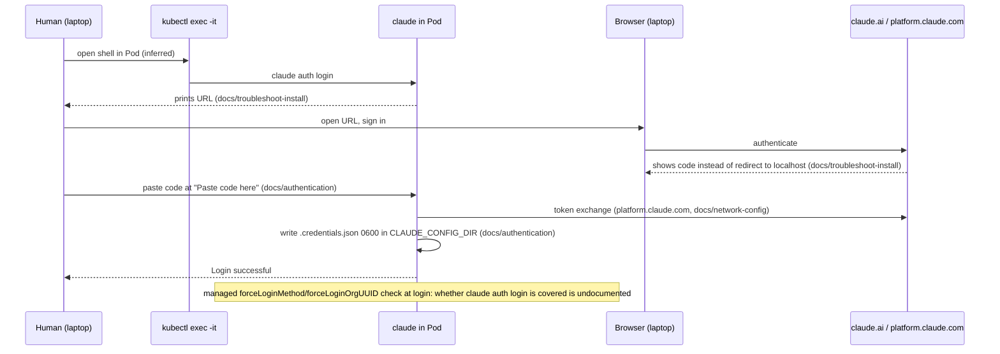

(b) First and second `claude-pod a ...` call.

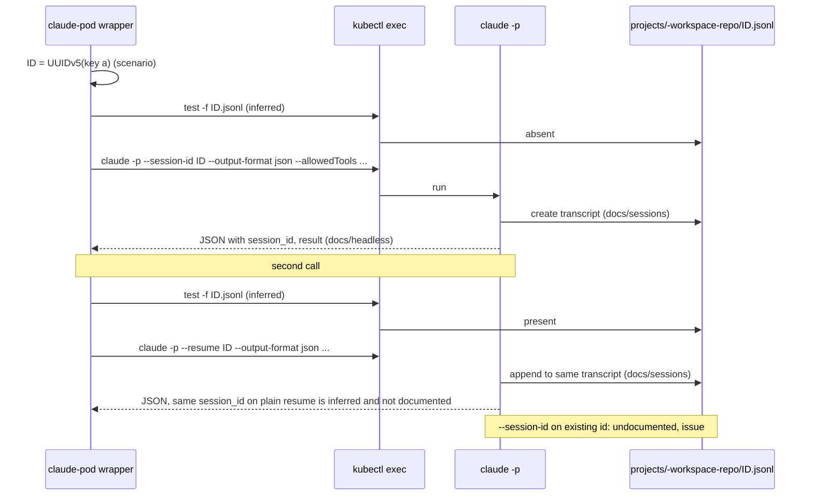

(c) Read of the credentials path vs a Bash read.

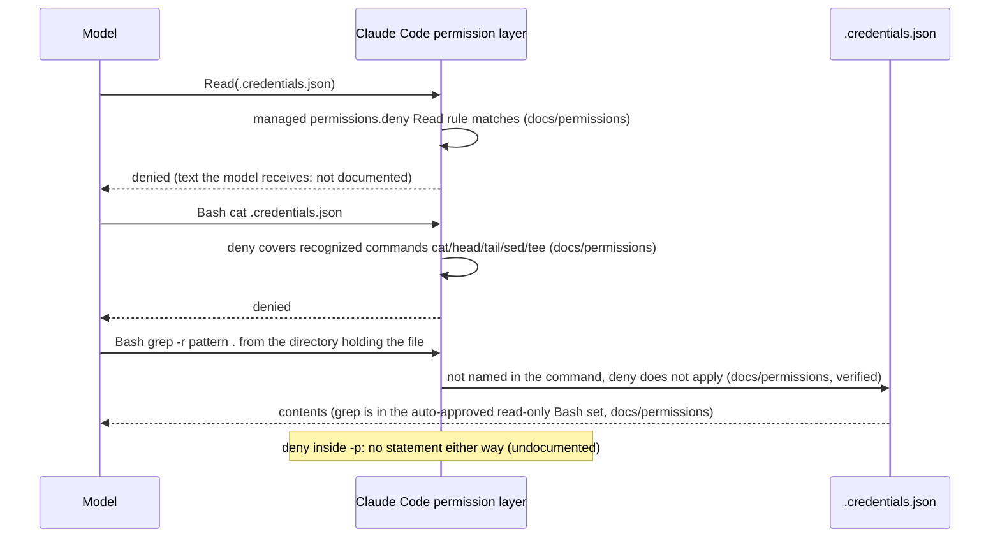

## External specs

Verbatim from the evidence:

> "They don't apply to a command that reads files without naming them, such as `grep -r pattern .` run from the directory that holds the file, or to arbitrary subprocesses ... For OS-level enforcement ... enable the sandbox." (docs/permissions, "What Read and Edit rules cover")

> "The set includes ls, cat, echo, pwd, head, tail, grep, find, wc, which, diff, stat, du, cd, and read-only forms of git. The set is not configurable" (docs/permissions, "Read-only commands")

> "Tools that execute without prompting for permission, apart from reads from network paths. ... To restrict which tools are available, use `--tools` instead." (docs/cli-reference, `--allowedTools`)

> "when you're signed in with your Claude plan, the Claude Agent SDK and `claude -p` still draw from your subscription limits." (https://support.claude.com/en/articles/15036540-use-the-claude-agent-sdk-with-your-claude-plan)

> "OAuth authentication is intended exclusively for purchasers of Claude Free, Pro, Max, Ultra, Team, and Enterprise subscription plans and is designed to support ordinary use of Claude Code and other native Anthropic applications." (docs/legal-and-compliance)

| Limit | Value | Source |
|---|---|---|
| FQDN policy, resolved IPs per policy | 50 | .../how-to/fqdn-network-policies |
| FQDN policy, IPs per hostname quota | 100 | same |
| Autopilot CPU min / max | 50m (bursting) or 250m / 30 vCPU | .../concepts/autopilot-resource-requests |
| Autopilot memory min / max | 52 MiB (bursting) or 512 MiB / 110 GiB | same |
| Autopilot ephemeral storage | 10 MiB - 10 GiB | same |
| Autopilot CPU:memory ratio | 1:1 to 1:6.5 | same |
| Claude Code host memory | 4 GB+ | docs/setup |

## Conventions

none found

## Constraints

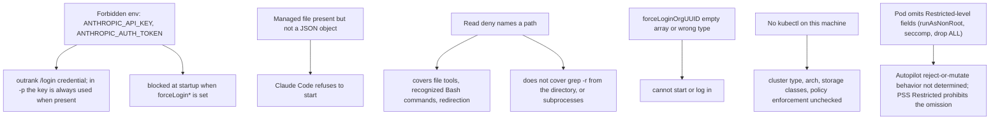

## Questions for the plan

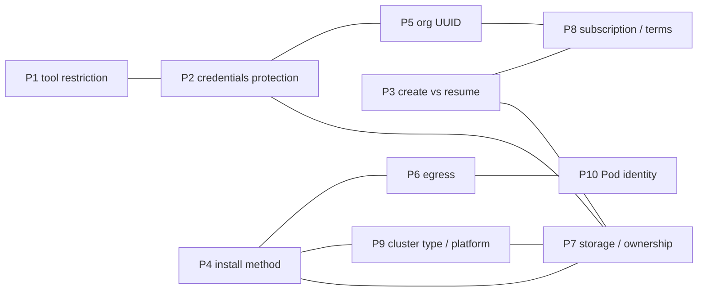

### P1 Tool restriction mechanism

| Option | Facts for | Facts against |
|---|---|---|
| `--allowedTools` | Executes listed tools without prompting; naming Grep/Glob restores both (docs/tools-reference) | Does not restrict availability; unlisted tools needing no approval run in `-p`; built-in read-only Bash set (cat, grep, find...) runs without prompt in every mode (docs/permissions, docs/headless) |
| `--tools` | "Restrict which built-in tools Claude can use" (docs/cli-reference) | Does not affect MCP tools; those need `--disallowedTools "mcp__*"` (docs/cli-reference) |
| `--disallowedTools` | Bare name removes tool from context (docs/cli-reference) | Scoped rule like `Bash(rm *)` denies only matching calls (docs/cli-reference) |
| `--permission-mode dontAsk` | Auto-denies anything that would prompt (docs/permission-modes) | Resumed `-p` starts in the mode a new run would; flags like `--mcp-config`, `--settings` not restored on resume (docs/sessions) |
| Managed keys (`allowManagedPermissionRulesOnly`, `disableBypassPermissionsMode`, ...) | Exist; the first also ignores `--allowedTools` (docs/settings-reference) | `Read(path)` applies best-effort to Grep/Glob; `Glob(path)` and `Write(path)` never match (docs/permissions) |
| `--bare` | `-p` without it runs project hooks and connects `.mcp.json` servers (docs/headless) | `--bare` never reads OAuth credentials (docs/authentication) |

Also: `-p` with no mode starts in Manual mode from v2.1.302; before it could start in auto mode on a third-party provider or with `DISABLE_TELEMETRY` (docs/headless, docs/permission-modes).

### P2 Credentials-file protection and verification

| Option | Facts for | Facts against |
|---|---|---|
| Managed `permissions.deny` Read rule | Ranks above CLI flags and user/project settings; lists combine across managed files (docs/settings, docs/managed-settings); applies to file tools and `cat/head/tail/sed/tee` (docs/permissions) | Not applied to `grep -r` from the holding directory or subprocesses; Bash read-only set includes cat/grep/find (docs/permissions); env vars in rule paths undocumented; managed-file path row for `/path` absent; Read rules best-effort for Grep/Glob; no statement on deny in `-p` (docs/permissions, docs/settings) |
| Sandbox | OS-level enforcement for Bash, PowerShell, Monitor and children (docs/permissions) | Does not cover Read/Grep/Glob (docs/permissions) |
| File mode | Credentials file is mode 0600, plaintext (docs/authentication, docs/claude-directory) | The process runs as the same user that owns the file (inferred) |
| Managed file as ConfigMap mount | Symlinks accepted, files reloaded on change (docs/managed-settings, docs/settings) | Unparseable file -> refuses to start; read-only mount and subPath not addressed (docs/managed-settings) |

### P3 Create-vs-resume logic and concurrency

| Option | Facts for | Facts against |
|---|---|---|
| File-existence test, then `--session-id` or `--resume` | `--session-id` must be a valid UUID (docs/cli-reference); transcript path is `projects/<project>/<id>.jsonl` (docs/sessions); issue #86761 describes the guard as a .jsonl existence test | Existing-id behavior undocumented; project dir depends on cwd or `CLAUDE_CODE_PROJECT_DIR_NAME` (docs/sessions); issue #87399 reports "in use" without a .jsonl (Windows) |
| Capture `session_id` from JSON, then `--resume` | Documented pattern with `jq -r '.session_id'` (docs/headless) | Equality of session_id on plain resume is inferred; no literal JSON example (docs/cli-reference, docs/headless) |
| Fix project dir name | `CLAUDE_CODE_PROJECT_DIR_NAME` v2.1.234+, 1-64 chars, needs CLAUDE_CONFIG_DIR (docs/sessions) | Version-gated |
| `--no-session-persistence` | Print-only flag (docs/cli-reference) | Makes sessions non-resumable |
| Concurrent calls on one key | Docs: resuming twice without forking interleaves into one transcript; `--fork-session` makes a new id (docs/sessions, docs/cli-reference) | Issue #75761 two processes append to one jsonl; none found on concurrent `-p --resume`; a rejected refresh clears credentials and every request fails (docs/errors) |

Further facts: `-p` sessions hidden from picker and `--continue` but found by `--resume <id>`; retention `cleanupPeriodDays` default 30; exit codes per failure not documented; issue #98610 empty stdout with exit 0; resume searches current project, worktrees, then other projects (v2.1.223+); issue #5768 (open) reports cwd-bound resume (docs/sessions, docs/claude-directory, docs/headless).

### P4 Installation method in the image

| Option | Facts for | Facts against |
|---|---|---|
| Native installer | `curl -fsSL https://claude.ai/install.sh \| bash`, `-s stable` or version (docs/setup) | Installs under the installing user's home; auto-update on; deletes old versions itself; unreadable binary in a running session -> Bus error (docs/setup); minimum glibc not found |
| npm | Official devcontainer Dockerfile uses `USER node` and pinned `npm install -g` (anthropics/claude-code `.devcontainer/Dockerfile`); binary does not invoke Node (docs/setup) | Needs Node 22+ to install; no sudo npm (docs/setup) |
| apt/dnf/apk | Repos at downloads.claude.ai (docs/setup) | No auto-update (docs/setup) |
| Update control | `DISABLE_AUTOUPDATER=1`; `DISABLE_UPDATES=1`; `CLAUDE_CODE_DISABLE_NONESSENTIAL_TRAFFIC` (docs/env-vars, docs/devcontainer) | `claude update` still works manually under DISABLE_AUTOUPDATER |

Platform facts: Alpine needs libgcc, libstdc++, ripgrep, `USE_BUILTIN_RIPGREP=0`; no-AVX CPUs give "Illegal instruction"; x64 or ARM64 (docs/setup, docs/troubleshoot-install). A native-installer non-root Dockerfile was not found.

### P5 forceLoginOrgUUID placeholder and org

| Option | Facts for | Facts against |
|---|---|---|
| Real org UUID | Shown at claude.ai/admin-settings/organization (Teams/Enterprise) or platform.claude.com/settings/organization (Console) (docs/authentication) | Source for a personal subscription not stated |
| Placeholder string | None found | Mismatch -> login error and exit at startup; format validation undocumented (docs/settings-reference, docs/authentication) |
| Omit key, keep `forceLoginMethod: claudeai` | `forceLoginMethod` values "claudeai", "console", "gateway" (docs/settings-reference) | `forceLoginOrgUUID` only enforced by a managed source; `claude auth login` not named in the enforcement list (docs/authentication) |
| Empty array | None | Users "can't start Claude Code or complete a login" (docs/authentication) |

Also: `ANTHROPIC_API_KEY`, `ANTHROPIC_AUTH_TOKEN`, `apiKeyHelper` blocked at startup when forceLogin* set; issue #56935 (closed, not planned) reports setup-token tokens fail; remote managed settings fetched only for direct API auth; managed file unparseable -> refuses to start (docs/authentication, docs/managed-settings).

### P6 Egress restriction method

| Option | Facts for | Facts against |
|---|---|---|
| No policy | By default all Pods communicate freely (network-policy page) | Not a restriction |
| IP/CIDR NetworkPolicy | Dataplane V2 enforcement always on in Autopilot; Calico in Standard (network-policy page) | Standard policy is IP/CIDR based (kubernetes.io); DPv2 + Workload Identity needs egress to 169.254.169.254/32 ports 80, 8080; DNS must be allowed incl. `node-local-dns`; no exact default-deny manifest found |
| FQDNNetworkPolicy | `name:`/`pattern:` hostnames (fqdn-network-policies page) | v1alpha1; max 50 resolved IPs per policy, 100 per hostname; Autopilot only via updating existing cluster; needs DPv2 and kube-dns or Cloud DNS |
| Proxy | `HTTPS_PROXY`/`NO_PROXY` supported (docs/network-config) | SOCKS proxies unsupported (docs/network-config) |

Endpoints (docs/network-config): api.anthropic.com, claude.ai, claude.com, platform.claude.com, sso.claude.com, downloads.claude.ai, mcp-proxy.anthropic.com (`ENABLE_CLAUDEAI_MCP_SERVERS=false` disables), storage.googleapis.com, registry.npmjs.org, github.com, raw.githubusercontent.com, Datadog intake hosts (optional telemetry; `DISABLE_TELEMETRY`/`DO_NOT_TRACK`), code.claude.com. `CLAUDE_CODE_DISABLE_NONESSENTIAL_TRAFFIC` disables auto-updates, telemetry, error reporting, feature-flag fetching (docs/env-vars). Login token exchange uses platform.claude.com.

### P7 Storage and volume ownership

| Option | Facts for | Facts against |
|---|---|---|
| PVC at CLAUDE_CONFIG_DIR | `.claude.json` moves inside CLAUDE_CONFIG_DIR when set; otherwise `~/.claude.json` is lost on rebuild (docs/env-vars, docs/devcontainer); StatefulSet keeps PVC on delete/scale-down (Retain, stable v1.32) | RWO only, zonal disk tied to one zone (concepts/persistent-volumes); `standard-rwo` uses WaitForFirstConsumer; credentials plaintext 0600 live on the volume; retention deletes files older than `cleanupPeriodDays` |
| fsGroup ownership | Recursive chown at mount; `fsGroupChangePolicy` OnRootMismatch/Always | Large PVs can make mounts fail; no effect on configMap/secret/emptyDir; PD driver VOLUME_MOUNT_GROUP support not determined; unset runAsGroup means GID 0 |
| Native-install paths | Launcher and versions under installing user's home (docs/setup) | `claude auth login --console` stores profile at `~/.config/anthropic`, outside CLAUDE_CONFIG_DIR (docs/authentication) |

Cluster storage classes on the live cluster: not checked.

### P8 Subscription and terms fit

| Option | Facts for | Facts against |
|---|---|---|
| Subscription login in Pod, `claude -p` | `claude -p` draws from subscription limits (support article, Oct 7, 2026); legal page does not prevent "an end user from signing in to the unmodified Claude Code binary with their own Claude subscription, including where a platform hosts Claude Code" (docs/legal-and-compliance) | OAuth "intended exclusively for purchasers of ... plans ... ordinary use"; limits "assume ordinary, individual usage"; Anthropic "may [enforce] without prior notice"; setup page says free plan lacks Claude Code (docs/legal-and-compliance, docs/setup); June 15, 2026 note says changes paused, "nothing has changed" |
| API-key authentication | Legal page: developers building products or services "should use API key authentication" | Out of scope; in `-p` the key is always used when present (docs/authentication) |

Also: developers "may not collect, store, or intermediate Claude.ai credentials or session tokens"; binary must not be modified; each end user authenticates with own credentials (docs/legal-and-compliance). Refresh failure in `-p` gives "OAuth session expired and could not be refreshed"; `/login` unavailable in `-p`. `-p` without `--bare` runs project hooks and `.mcp.json` servers (docs/headless). Token TTLs not found.

### P9 Cluster type and image platform

| Option | Facts for | Facts against |
|---|---|---|
| Autopilot | Default `standard-rwo`; DPv2 default; WI always on; RuntimeDefault seccomp applied (autopilot-security) | Resource min/max and ratio limits; strictly enforced security measures; reject-vs-mutate of non-Restricted Pods not determined; FQDN policy enabled only by updating an existing cluster |
| Standard | Calico available for NetworkPolicy (network-policy page) | NetworkPolicy without DPv2 needs add-on, enforced on node re-creation |
| x86 image | GKE schedules x86 nodes by default (prepare-arm-workloads) | Apple Silicon builds arm64 by default (not sourced) |
| arm64 or multi-arch image | Multi-arch images schedule on either; Claude Code supports ARM64 (docs/setup) | Arm nodes tainted `kubernetes.io/arch=arm64:NoSchedule` |
| Restricted-style securityContext | PSS Restricted fields listed (kubernetes.io PSS page); allowPrivilegeEscalation true if unset | GKE default pod-security namespace labels not determined |

Also: Artifact Registry push path and `gcloud auth configure-docker`; creation names `roles/artifactregistry.admin`; node pull via Compute Engine default SA, `roles/artifactregistry.reader` if Editor disabled; `kubectl` needs `gke-gcloud-auth-plugin`, exec needs `pods/exec` (cluster-access-for-kubectl); minimum 4 GB RAM for Claude Code; Alpine needs extra packages. Live cluster type and node arch: not checked.

### P10 Pod identity

| Option | Facts for | Facts against |
|---|---|---|
| Workload Identity with a no-permission KSA | Always on in Autopilot; enabling grants no IAM permissions; Pods with no KSA use the namespace `default` KSA | Compute metadata server unreachable once the GKE metadata server is on; hostNetwork Pods don't use it |
| No Workload Identity | None | Pods inherit the node service account; "Each node's service account credentials continue to be exposed to workloads." |
| `automountServiceAccountToken: false` | Stops mounting the Kubernetes API token (ServiceAccount or Pod; Pod wins) | Page does not address GCP access |

Source for all P10 rows: https://docs.cloud.google.com/kubernetes-engine/docs/concepts/workload-identity; .../how-to/workload-identity; .../how-to/protecting-cluster-metadata; https://kubernetes.io/docs/tasks/configure-pod-container/configure-service-account/ (sub-agent).

### Could not be determined

| Item | Who could answer |
|---|---|
| Cluster type (Autopilot/Standard), node arch, current context, storage classes, NetworkPolicy enforcement | Running the live cluster |
| Whether Autopilot rejects or mutates a Pod missing Restricted fields; GKE default pod-security labels | Running the live cluster |
| reclaimPolicy of `standard-rwo`; PD driver VOLUME_MOUNT_GROUP support | Running the live cluster |
| Whether `container.developer` includes `pods/exec` | Running the live cluster |
| Behavior of `--session-id` on an existing id in `-p`; exit code for missing session / denied tool / is_error | A test in the Pod |
| Whether deny rules apply in `-p`; text the model receives for a denied tool | A test in the Pod |
| Env-var expansion in deny rule paths; ConfigMap/read-only mount behavior of the managed file | A test in the Pod |
| forceLoginOrgUUID placeholder handling; whether `claude auth login` enforces it | A test in the Pod |
| Same session_id after plain resume; literal JSON of `-p --output-format json`; concurrent `-p --resume` | A test in the Pod |
| Retention basis (mtime vs creation) | A test in the Pod |
| Access/refresh token lifetimes; minimum glibc | A test in the Pod |
| Whether the personal subscription type has an org UUID and where it is shown | The user |
| Which plan the user holds and its terms fit | The user |

## Sources

- https://code.claude.com/docs/en/setup
- https://code.claude.com/docs/en/troubleshoot-install
- https://code.claude.com/docs/en/devcontainer
- https://code.claude.com/docs/en/env-vars
- https://code.claude.com/docs/en/claude-directory
- https://code.claude.com/docs/en/authentication
- https://code.claude.com/docs/en/sessions
- https://code.claude.com/docs/en/cli-reference
- https://code.claude.com/docs/en/headless
- https://code.claude.com/docs/en/permissions
- https://code.claude.com/docs/en/permission-modes
- https://code.claude.com/docs/en/tools-reference
- https://code.claude.com/docs/en/managed-settings
- https://code.claude.com/docs/en/settings
- https://code.claude.com/docs/en/settings-reference
- https://code.claude.com/docs/en/network-config
- https://code.claude.com/docs/en/errors
- https://code.claude.com/docs/en/legal-and-compliance
- https://code.claude.com/docs/en/agent-sdk/typescript
- https://raw.githubusercontent.com/anthropics/claude-code/main/.devcontainer/Dockerfile
- https://github.com/anthropics/claude-code/issues/86761, /87399, /5768, /75761, /98610, /56935
- https://support.claude.com/en/articles/15036540-use-the-claude-agent-sdk-with-your-claude-plan
- https://support.claude.com/en/articles/11145838-using-claude-code-with-your-pro-or-max-plan
- https://docs.cloud.google.com/kubernetes-engine/docs/concepts/persistent-volumes
- https://docs.cloud.google.com/kubernetes-engine/docs/how-to/persistent-volumes/gce-pd-csi-driver
- https://docs.cloud.google.com/kubernetes-engine/docs/concepts/autopilot-security
- https://docs.cloud.google.com/kubernetes-engine/docs/concepts/autopilot-resource-requests
- https://docs.cloud.google.com/kubernetes-engine/docs/how-to/network-policy
- https://docs.cloud.google.com/kubernetes-engine/docs/how-to/nodelocal-dns-cache
- https://docs.cloud.google.com/kubernetes-engine/docs/how-to/fqdn-network-policies
- https://docs.cloud.google.com/kubernetes-engine/docs/concepts/workload-identity
- https://docs.cloud.google.com/kubernetes-engine/docs/how-to/workload-identity
- https://docs.cloud.google.com/kubernetes-engine/docs/how-to/protecting-cluster-metadata
- https://docs.cloud.google.com/kubernetes-engine/docs/how-to/prepare-arm-workloads-for-deployment
- https://docs.cloud.google.com/kubernetes-engine/docs/how-to/cluster-access-for-kubectl
- https://docs.cloud.google.com/artifact-registry/docs/docker/authentication
- https://docs.cloud.google.com/artifact-registry/docs/docker/store-docker-container-images
- https://docs.cloud.google.com/artifact-registry/docs/integrate-gke
- https://kubernetes.io/docs/tasks/configure-pod-container/security-context/
- https://kubernetes.io/docs/concepts/workloads/controllers/statefulset/
- https://kubernetes.io/docs/concepts/security/pod-security-standards/
- https://kubernetes.io/docs/concepts/services-networking/network-policies/
- https://kubernetes.io/docs/tasks/configure-pod-container/configure-service-account/

## Evidence gaps

- Minimum glibc version; a documented native-installer non-root Dockerfile.
- Exit codes for missing session, denied tool, is_error; literal JSON example of `-p --output-format json`.
- Behavior of `--session-id` with an existing id in `-p` (only GitHub issues).
- Placeholder/format handling of forceLoginOrgUUID; whether `claude auth login` enforces it.
- Read-only mount / ConfigMap subPath behavior of the managed file; env-var expansion in rule paths; deny behavior in `-p`.
- Access/refresh token TTLs; `--claudeai` flag.
- Live cluster state (type, arch, storage classes, NetworkPolicy enforcement, context); Autopilot reject-vs-mutate; default pod-security labels; reclaimPolicy of `standard-rwo`; PD driver VOLUME_MOUNT_GROUP; `pods/exec` in `container.developer`.
- Retention mtime-vs-creation basis.
